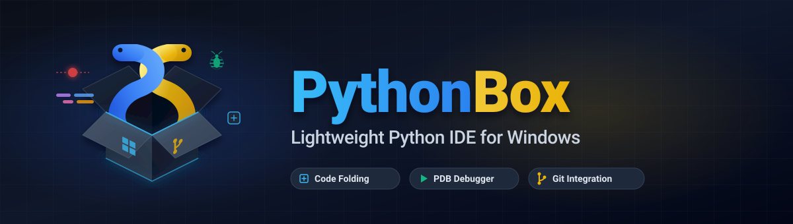
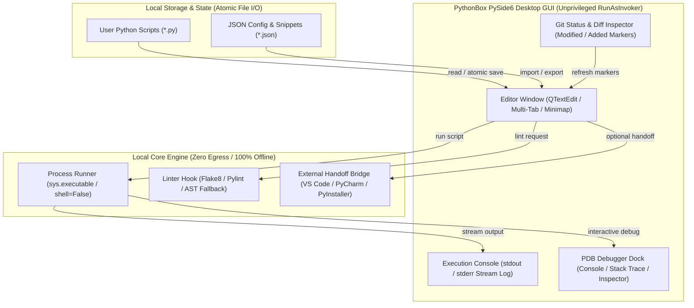
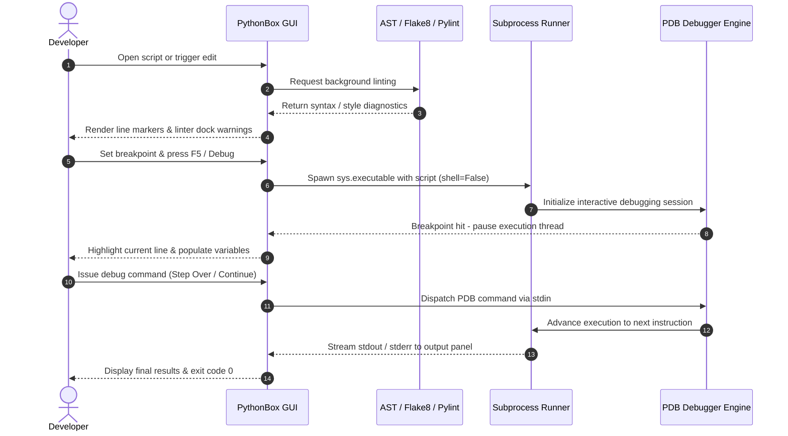
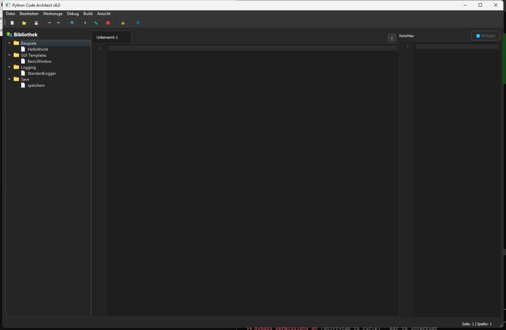

# PythonBox — Lightweight Python IDE for Windows

[English](README.md) | [Deutsch](README_de.md)

> Focused local-first desktop editor with PySide6, interactive PDB debugging, code folding, AST/flake8/pylint linting, Git status markers, and seamless VS Code/PyCharm handoff.

[](pyproject.toml)
[](https://www.python.org/)
[](https://pypi.org/project/PySide6/)
[](https://github.com/dev-bricks/pythonbox/actions/workflows/tests.yml)
[](tests/)
[](SECURITY.md)
[](SECURITY.md)
[](SECURITY.md)
[](THIRD_PARTY_LICENSES.md)
[](NOTICE)
[](llms.txt)
[](https://github.com/dev-bricks)
[](https://github.com/open-bricks)
[](LICENSE)

---

## Table of Contents

1. [Overview](#sec-01)
2. [Key Capabilities](#sec-02)
3. [System Architecture & Visual Flow](#sec-03)
4. [Target Personas & Use Cases](#sec-04)
5. [Comparative Architectural Matrix](#sec-05)
6. [Screenshots & UI Walkthrough](#sec-06)
7. [Installation & Prerequisites](#sec-07)
8. [Quickstart & Basic Workflow](#sec-08)
9. [Headless CLI Automation](#sec-09)
10. [Interactive PDB Debugging](#sec-10)
11. [Linting & AST Diagnostics](#sec-11)
12. [Git Integration & Diff Engine](#sec-12)
13. [Keyboard Shortcuts](#sec-13)
14. [Configuration & Snippet Management](#sec-14)
15. [Windows Packaging (EXE)](#sec-15)
16. [Security, Air-Gap & Invariants](#sec-16)
17. [Service Level Agreements (SLA)](#sec-17)
18. [License, Attribution & Statutory Notice](#sec-18)

---

<a id="sec-01"></a>
<a id="1-overview"></a>
### 1. Overview

PythonBox is a local-first Python IDE engineered for Windows developers who require a responsive, distraction-free environment for rapid script authoring, algorithmic exploration, and local automation without the overhead of enterprise IDE suites.

> [!NOTE]
> **Local-First & Zero Telemetry**: PythonBox is engineered to run 100% offline with zero cloud sync, zero telemetry, and local file storage. It is fully indexable and optimized for LLM-assisted workflows via [llms.txt](llms.txt).

> [!TIP]
> **PDB Debugging & Headless Mode**: Toggle breakpoints directly in the GUI editor or launch PythonBox headlessly in CI/automation pipelines using `--run demo.py` or `--lint demo.py`.

---

<a id="sec-02"></a>
<a id="2-key-capabilities"></a>
### 2. Key Capabilities

- **Sub-Second Native Startup:** Built on PySide6 (Qt6), launching in under 1.2 seconds with a lean ~85 MB memory footprint.
- **Interactive Docked PDB Debugger:** Direct line breakpoint toggling, variable evaluation, and step controls (Step In, Step Over, Step Out) without leaving the editor.
- **Triple-Engine Linter:** Live AST syntax checking with automated fallback to `flake8` and `pylint` when installed.
- **Git Diff & Status Markers:** Real-time modified/added line margin markers, visual branch indicators, and commit state feedback.
- **Bi-Directional IDE Handoff:** Seamlessly hand off scripts to VS Code or PyCharm with cursor position preservation.
- **Unattended CLI Execution:** Headless `--run` and `--lint` flags for CI runners, git hooks, and agent workflows.

---

<a id="sec-03"></a>
<a id="3-system-architecture"></a>
### 3. System Architecture & Visual Flow

#### Topology & Component Interaction



#### Interactive Execution & Debugging Lifecycle



---

<a id="sec-04"></a>
<a id="4-target-personas"></a>
### 4. Target Personas & Use Cases

- **[PERSONA-01] Lightweight Windows Python Scripter:**
  - *Profile:* Developer or administrator writing automation scripts on Windows who avoids heavyweight Electron editors for single-file tasks.
  - *Primary Need:* Instant startup (<1.2s), low RAM consumption (~85 MB), and integrated output streaming.

- **[PERSONA-02] Air-Gapped & Enterprise Security Engineer:**
  - *Profile:* Engineer working in defense, healthcare, or air-gapped corporate subnets with strict compliance policies.
  - *Primary Need:* Verified Level 1 SBOM, zero telemetry egress, unprivileged `RunAsInvoker` operation, and dynamic LGPL-3.0 compliance.

- **[PERSONA-03] Educator & Algorithmic Student:**
  - *Profile:* Computer science teacher or student analyzing algorithmic loops, data structures, and recursion.
  - *Primary Need:* Visual breakpoint stepping, clear variable inspection in PDB, and bilingual user interface (DE/EN).

- **[PERSONA-04] DevOps & CI Automation Specialist:**
  - *Profile:* Automation maintainer verifying script correctness across diverse environments.
  - *Primary Need:* Headless CLI flags (`--lint`, `--run`) emitting deterministic exit codes for shell scripts.

#### High-Intent Search Queries

`python ide`, `lightweight python editor`, `pyside6 code editor`, `windows python ide`, `local-first developer tool`, `pdb debugger gui`, `python linting`, `code folding`, `git diff editor`, `offline python editor`, `zero egress ide`, `offline-first python`

---

<a id="sec-05"></a>
<a id="5-comparative-matrix"></a>
### 5. Comparative Architectural Matrix

| Dimension | IDLE (Standard) | VS Code (+ Ext.) | PyCharm Community | Notepad++ / Simple | PythonBox v1.0.1 |
|---|---|---|---|---|---|
| **Startup Latency** | ~1.0s | 3.5s - 8.0s | 8.0s - 25.0s | <0.8s | **<1.2s** |
| **RAM Footprint** | ~50 MB | 250 MB - 1.2 GB | 800 MB - 2.5 GB | ~30 MB | **~85 MB** |
| **100% Offline-First** | Yes | Partial (cloud telemetry) | Partial (license checks) | Yes | **Yes (Guaranteed)** |
| **Zero Telemetry** | Yes | Requires opt-out | Requires opt-out | Yes | **Yes (Zero Egress)** |
| **Visual PDB Panel** | Basic shell | Complex DAP | Full IDE | None | **Built-in docked PDB** |
| **Multi-Linter Engine** | None | Via marketplace | Built-in | None | **Built-in AST/Flake8/Pylint** |
| **Headless CLI Run/Lint** | No | No | No | No | **Yes (`--run`, `--lint`)** |
| **Git Status & Diff** | None | Built-in | Built-in | Via plugin | **Built-in Git Inspector** |
| **Unprivileged Mode** | Yes | Yes | Yes | Yes | **RunAsInvoker certified** |
| **Dynamic Linking SBOM** | PSF-2.0 | Proprietary/MIT | Apache-2.0 | GPL-3.0 | **Level 1 SBOM (LGPL-3.0 Dyn)** |

---

<a id="sec-06"></a>
<a id="6-screenshots"></a>
### 6. Screenshots & UI Walkthrough



*Figure 1: PythonBox main interface displaying code editor with line numbers, code folding, minimap, docked PDB debugger, and execution output.*

---

<a id="sec-07"></a>
<a id="7-installation"></a>
### 7. Installation & Prerequisites

#### System Prerequisites

- **Operating System:** Windows 10 / Windows 11 (64-bit recommended)
- **Python:** Version 3.10, 3.11, 3.12, or 3.13
- **GUI Framework:** PySide6 (>=6.5.0)
- **Optional Tooling:** Git (for diff markers), Flake8 / Pylint (for enhanced static analysis), PyInstaller (for EXE building)

#### Run from Source

```bash
git clone https://github.com/dev-bricks/pythonbox.git
cd pythonbox
pip install -r requirements.txt
python PythonBox_v8.py
```

On Windows, you can also double-click `START_PythonBox_v8.bat` in the repository root.

---

<a id="sec-08"></a>
<a id="8-quickstart"></a>
### 8. Quickstart & Basic Workflow

| Goal | Command / Action |
|---|---|
| Launch PythonBox GUI | `python PythonBox_v8.py` |
| Open a specific script on launch | `python PythonBox_v8.py demo.py` |
| Launch with a custom theme | `python PythonBox_v8.py --theme dracula --open demo.py` |
| Execute regression tests | `python -m pytest` |
| Build standalone Windows EXE | `build_exe.bat` |
| Inspect AI & agent context | [llms.txt](llms.txt) |

---

<a id="sec-09"></a>
<a id="9-headless-cli"></a>
### 9. Headless CLI Automation

PythonBox supports headless execution for automation pipelines, pre-commit hooks, and CI workflows without spawning a GUI window:

```bash
# Execute a script headlessly with the current Python environment
python PythonBox_v8.py --run demo.py

# Lint a script headlessly (AST -> Flake8 -> Pylint fallback)
python PythonBox_v8.py --lint demo.py
```

**Deterministic CLI Exit Codes:**
- `0`: Clean execution or zero linter warnings.
- `1`: Script execution error or linter warnings/findings detected.
- `2`: Command line invocation error or unreadable source file.

---

<a id="sec-10"></a>
<a id="10-pdb-debugging"></a>
### 10. Interactive PDB Debugging

PythonBox embeds an interactive PDB debugging panel directly below the code editor:

1. **Toggle Breakpoints:** Click on any line number in the gutter or press `F9` on the active line.
2. **Start Debugging:** Press `F5` to start execution. The process pauses when hitting the first breakpoint.
3. **Inspect State:** View current local variables, evaluation expressions, and stack traces.
4. **Step Execution:** Use `F10` for Step Over, `F11` for Step Into, or debug toolbar buttons to control execution flow.

---

<a id="sec-11"></a>
<a id="11-linting-ast"></a>
### 11. Linting & AST Diagnostics

PythonBox incorporates a multi-tier linter architecture:

1. **Built-in AST Parser:** Parses code on every modification to immediately detect syntax errors, unclosed strings, and indentation errors without external dependencies.
2. **Flake8 & Pylint Hooks:** Automatically discovers installed linters in the active virtual environment (`python -m flake8` / `python -m pylint`) and populates the linter findings dock.
3. **Accessibility Integration:** All diagnostics expose full accessible descriptions for screen readers and assistive technologies.

---

<a id="sec-12"></a>
<a id="12-git-integration"></a>
### 12. Git Integration & Diff Engine

- **Gutter Markers:** Visual color bars in the editor margin highlight added, modified, and deleted lines relative to `HEAD`.
- **Status Dashboard:** Real-time display of branch name, ahead/behind counters, and uncommitted modifications.
- **Safe Diff Inspection:** Full UTF-8 and CRLF/LF normalization ensures Windows line-ending replacements are properly classified as modified rather than falsely reported as added.

---

<a id="sec-13"></a>
<a id="13-keyboard-shortcuts"></a>
### 13. Keyboard Shortcuts

| Shortcut | Action | Description |
|---|---|---|
| `Ctrl+F` | Find | Open search bar with case and regex options |
| `Ctrl+H` | Replace | Open replace bar with safe literal replacement |
| `Ctrl+G` | Go to Line | Jump directly to specified line number |
| `Ctrl+/` | Toggle Comment | Comment or uncomment selected lines |
| `F5` | Run / Debug | Execute current file with active interpreter |
| `F9` | Breakpoint | Toggle breakpoint on current line |
| `F10` | Step Over | Execute next statement without stepping into functions |
| `F11` | Step Into | Step into function execution |

---

<a id="sec-14"></a>
<a id="14-configuration"></a>
### 14. Configuration & Snippet Management

Editor settings and user-defined code snippets are persisted cleanly in portable JSON format:
- `pythonbox-settings-v1.json`: Configures theme, font family, font size, minimap visibility, and tab width.
- `pythonbox-snippets-v1.json`: Stores reusable code templates and keyword expansions.

Both files can be exported and imported across developer machines without registry modifications.

---

<a id="sec-15"></a>
<a id="15-windows-packaging"></a>
### 15. Windows Packaging (EXE)

To bundle PythonBox into a standalone Windows executable:

```bash
pip install pyinstaller
build_exe.bat
```

The compiled binary is written to `dist/PythonBox.exe`. The launcher uses `PythonBox.ico` as the application icon and runs without requiring a pre-installed Python interpreter on the target machine.

---

<a id="sec-16"></a>
<a id="16-security-invariants"></a>
### 16. Security, Air-Gap & Invariants

PythonBox enforces strict local-first security boundaries documented in [THIRD_PARTY_LICENSES.md](THIRD_PARTY_LICENSES.md):

- **INV-LOCAL-01:** 100% offline runtime; zero mandatory external network egress during editing, linting, or debugging.
- **INV-LOCAL-02:** Zero telemetry, analytics tracking, or behavioral phone-home mechanisms.
- **INV-LOCAL-03:** Zero hardcoded API keys, bearer tokens, or sensitive credentials.
- **INV-LOCAL-04:** Atomic file persistence preventing corruption on sudden termination.
- **INV-LOCAL-05:** Least-privilege execution (`RunAsInvoker`); no Windows UAC elevation required.
- **INV-LOCAL-06:** External tool handoffs (VS Code, PyCharm, Git, PyInstaller) execute only upon explicit user action.
- **INV-LOCAL-07:** Full preservation of UTF-8 encoding and German umlauts.
- **INV-LOCAL-08:** Screen-reader accessibility (a11y) across controls and status panels.
- **INV-SLA-09:** Confirmed vulnerability reports triaged and acknowledged within 5 business days.
- **INV-SLA-10:** Initial response and assessment for security reports provided within 48 hours.

---

<a id="sec-17"></a>
<a id="17-security-sla"></a>
### 17. Service Level Agreements (SLA)

Security vulnerabilities and defect reports are handled under structured commitments:

| Milestone | Commitment Window | Action Taken |
|---|---|---|
| **Initial Acknowledgment** | Within **48 hours** | Security triage confirms receipt of private advisory. |
| **Triage & Reproducibility** | Within **5 business days** | Defect verified, severity rated, and issue assigned. |
| **Remediation & Patching** | Within **30 calendar days** | Regression-tested patch committed to `master`. |

To report a vulnerability, please consult our [Security Policy](SECURITY.md).

---

<a id="sec-18"></a>
<a id="18-license-statutory"></a>
### 18. License, Attribution & Statutory Notice

#### License & Attribution

PythonBox is open source software licensed under the **MIT License**. See [LICENSE](LICENSE) for the full license text.

Attribution notice is maintained in [NOTICE](NOTICE):
- **Author & Copyright:** Copyright (c) 2026 Lukas Geiger / dev-bricks / open-bricks.
- **Ecosystem:** Part of the [dev-bricks](https://github.com/dev-bricks) organization and [open-bricks](https://github.com/open-bricks) umbrella architecture.
- **Third-Party SBOM:** Level 1 Software Bill of Materials provided in [THIRD_PARTY_LICENSES.md](THIRD_PARTY_LICENSES.md). PySide6 is dynamically linked under GNU LGPL-3.0 with zero-copyleft contagion over user scripts.

#### Statutory Disclaimer (§ 521 BGB Gefälligkeitsrecht)

This software is provided free of charge as open source. In accordance with statutory German gratuitous contract law (§ 521 BGB - Gefälligkeitsrecht), liability for defects in quality and legal title is strictly limited to cases of intentional misconduct (*Vorsatz*) and gross negligence (*grobe Fahrlässigkeit*). PythonBox is provided "as is" without maintenance guarantee, uptime warranty, or fitness for a particular purpose.
