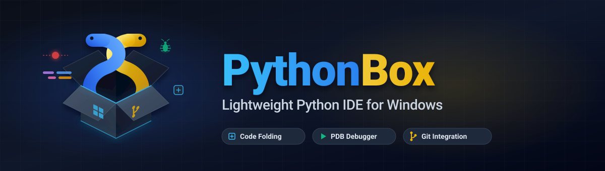
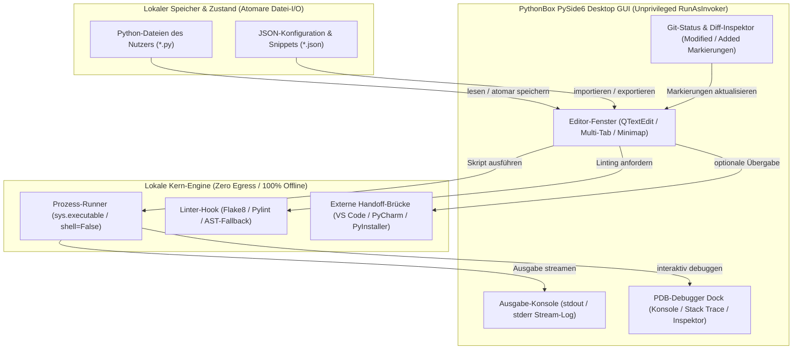
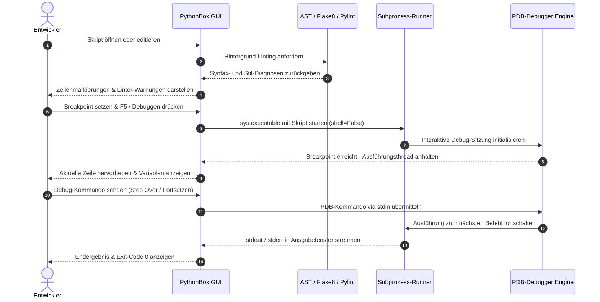
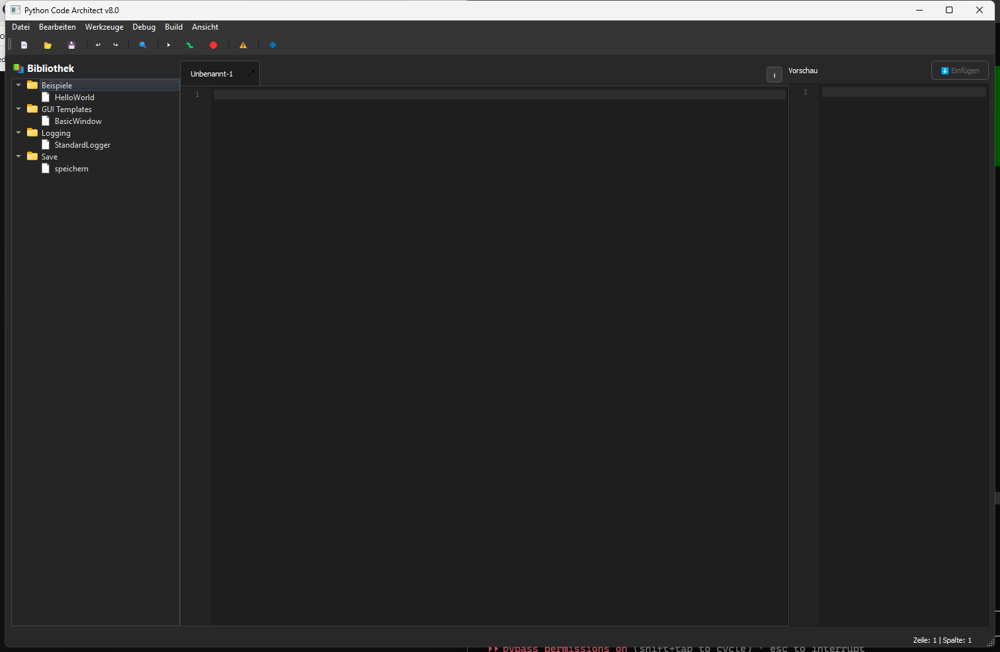

# PythonBox — Schlanke Python-IDE für Windows

[English](README.md) | [Deutsch](README_de.md)

> Fokussierter, lokaler Desktop-Editor mit PySide6, interaktivem PDB-Debugging, Code Folding, AST/Flake8/Pylint-Linting, Git-Statusanzeigen und nahtloser Übergabe an VS Code/PyCharm.

[](pyproject.toml)
[](https://www.python.org/)
[](https://pypi.org/project/PySide6/)
[](https://github.com/dev-bricks/pythonbox/actions/workflows/tests.yml)
[](tests/)
[](SECURITY.md)
[](SECURITY.md)
[](SECURITY.md)
[](THIRD_PARTY_LICENSES.md)
[](NOTICE)
[](llms.txt)
[](https://github.com/dev-bricks)
[](https://github.com/open-bricks)
[](LICENSE)

---

## Inhaltsverzeichnis

1. [Überblick](#sec-01)
2. [Hauptmerkmale](#sec-02)
3. [Systemarchitektur & Visueller Ablauf](#sec-03)
4. [Zielgruppen & Anwendungsfälle](#sec-04)
5. [Vergleichsmatrix der Architektur](#sec-05)
6. [Screenshots & Benutzeroberfläche](#sec-06)
7. [Installation & Voraussetzungen](#sec-07)
8. [Schnellstart & Grundlegender Workflow](#sec-08)
9. [Headless CLI-Automatisierung](#sec-09)
10. [Interaktives PDB-Debugging](#sec-10)
11. [Linting & AST-Diagnostik](#sec-11)
12. [Git-Integration & Diff-Engine](#sec-12)
13. [Tastaturkürzel](#sec-13)
14. [Konfiguration & Snippet-Verwaltung](#sec-14)
15. [Windows-Paketierung (EXE)](#sec-15)
16. [Sicherheit, Air-Gap & Invarianten](#sec-16)
17. [Service Level Agreements (SLA)](#sec-17)
18. [Lizenz, Attribution & Gesetzlicher Hinweis](#sec-18)

---

<a id="sec-01"></a>
<a id="1-ueberblick"></a>
### 1. Überblick

PythonBox ist eine lokale Python-IDE für Windows-Entwicklerinnen und -Entwickler, die eine reaktionsschnelle, ablenkungsfreie Arbeitsumgebung für Skripterstellung, Algorithmenentwurf und lokale Automatisierung ohne den Ballast schwerfälliger IDE-Suiten suchen.

> [!NOTE]
> **Local-First & Zero-Telemetry**: PythonBox läuft 100% lokal ohne Cloud-Zwang, ohne Telemetrie und speichert Daten ausschließlich auf dem lokalen Dateisystem. Das Repository ist für KI-Agenten und LLM-Workflows über [llms.txt](llms.txt) optimiert.

> [!TIP]
> **PDB-Debugging & Headless-Modus**: Breakpoints lassen sich direkt im GUI-Editor setzen oder in CI/Automatisierungs-Pipelines headless über `--run demo.py` bzw. `--lint demo.py` ausführen.

---

<a id="sec-02"></a>
<a id="2-hauptmerkmale"></a>
### 2. Hauptmerkmale

- **Sub-Sekunden-Startzeit:** Basiert auf PySide6 (Qt6) und startet in unter 1,2 Sekunden bei einem schlanken RAM-Bedarf von ~85 MB.
- **Interaktiver PDB-Debugger:** Breakpoints direkt per Zeilennummer umschalten, Variablen inspizieren und Schritt-für-Schritt-Steuerung (Step In, Step Over, Step Out) im Editor-Dock nutzen.
- **Dreistufige Linter-Engine:** Live AST-Syntaxprüfung mit automatischem Fallback auf `flake8` und `pylint`, sofern in der Python-Umgebung installiert.
- **Git-Diff & Status-Markierungen:** Echtzeit-Randleistenmarkierungen für geänderte/neue Zeilen, Anzeige des aktuellen Branches und Status-Feedback.
- **Nahtlose IDE-Übergabe:** Direkte Übergabe der aktuellen Datei an VS Code oder PyCharm inklusive Cursorposition.
- **Headless CLI-Ausführung:** Befehlszeilen-Flags `--run` und `--lint` für CI-Runner, Git-Hooks und automatisierte Agentenläufe.

---

<a id="sec-03"></a>
<a id="3-systemarchitektur"></a>
### 3. Systemarchitektur & Visueller Ablauf

#### Topologie & Komponenten-Interaktion



#### Interaktiver Ausführungs- & Debugging-Lebenszyklus



---

<a id="sec-04"></a>
<a id="4-zielgruppen"></a>
### 4. Zielgruppen & Anwendungsfälle

- **[PERSONA-01] Schlanker Windows-Python-Scripter:**
  - *Profil:* Entwickler oder Systemadministrator, der Automatisierungsskripte auf Windows schreibt und für Einzelskripte keine schwere Electron-IDE laden möchte.
  - *Kernbedarf:* Sofortiger Start (<1,2s), minimaler RAM-Verbrauch (~85 MB) und integrierte Konsolenausgabe.

- **[PERSONA-02] Air-Gapped & Enterprise-Sicherheitsingenieur:**
  - *Profil:* Ingenieur in sicherheitskritischen Bereichen (Finanzen, Medizin, Behörden) mit strikten Compliance-Vorgaben.
  - *Kernbedarf:* Verifizierte Level-1-SBOM, null Telemetrie-Egress, unprivilegierte `RunAsInvoker`-Ausführung und saubere LGPL-3.0-Dynamikbindung.

- **[PERSONA-03] Lehrende & Algorithmen-Lernende:**
  - *Profil:* Informatiklehrkraft oder Studierende, die Schleifen, Datenstrukturen und Rekursionen nachvollziehen möchten.
  - *Kernbedarf:* Visuelles Durchsteppen von Breakpoints, klare Variablenanzeige im PDB und zweisprachige Menüführung (DE/EN).

- **[PERSONA-04] DevOps & CI-Automatisierer:**
  - *Profil:* Automatisierungsspezialist zur Validierung von Skripten in automatisierten Workflows.
  - *Kernbedarf:* Headless CLI-Schalter (`--lint`, `--run`) mit deterministischen Exit-Codes für Batch- und Shell-Prozesse.

#### Relevante Suchbegriffe (SEO & Discovery)

`python ide`, `lightweight python editor`, `pyside6 code editor`, `windows python ide`, `local-first developer tool`, `pdb debugger gui`, `python linting`, `code folding`, `git diff editor`, `offline python editor`, `zero egress ide`, `offline-first python`

---

<a id="sec-05"></a>
<a id="5-vergleichsmatrix"></a>
### 5. Vergleichsmatrix der Architektur

| Dimension | IDLE (Standard) | VS Code (+ Ext.) | PyCharm Community | Notepad++ / Simple | PythonBox v1.0.1 |
|---|---|---|---|---|---|
| **Startzeit** | ~1,0s | 3,5s - 8,0s | 8,0s - 25,0s | <0,8s | **<1,2s** |
| **RAM-Bedarf** | ~50 MB | 250 MB - 1,2 GB | 800 MB - 2,5 GB | ~30 MB | **~85 MB** |
| **100% Offline-First** | Ja | Eingeschränkt (Cloud-Dienste) | Eingeschränkt (Prüfungen) | Ja | **Ja (Garantiert)** |
| **Null Telemetrie** | Ja | Opt-out erforderlich | Opt-out erforderlich | Ja | **Ja (Zero Egress)** |
| **Visuelles PDB-Dock** | Einfache Shell | Komplexes DAP | Integrierte Engine | Keine | **Eingebautes PDB-Dock** |
| **Multi-Linter Engine** | Keine | Über Marketplace | Integriert | Keine | **Integriertes AST/Flake8/Pylint** |
| **Headless CLI Run/Lint** | Nein | Nein | Nein | Nein | **Ja (`--run`, `--lint`)** |
| **Git Status & Diff** | Keine | Integriert | Integriert | Über Plugin | **Integrierter Git-Inspektor** |
| **Unprivilegierter Modus** | Ja | Ja | Ja | Ja | **RunAsInvoker-zertifiziert** |
| **Dynamische SBOM** | PSF-2.0 | Proprietär/MIT | Apache-2.0 | GPL-3.0 | **Level 1 SBOM (LGPL-3.0 Dyn)** |

---

<a id="sec-06"></a>
<a id="6-screenshots"></a>
### 6. Screenshots & Benutzeroberfläche



*Abbildung 1: Hauptansicht von PythonBox mit Zeilennummern, Code Folding, Minimap, angedocktem PDB-Debugger und Konsolenausgabe.*

---

<a id="sec-07"></a>
<a id="7-installation"></a>
### 7. Installation & Voraussetzungen

#### Systemvoraussetzungen

- **Betriebssystem:** Windows 10 / Windows 11 (64-Bit empfohlen)
- **Python:** Version 3.10, 3.11, 3.12 oder 3.13
- **GUI-Framework:** PySide6 (>=6.5.0)
- **Optionale Werkzeuge:** Git (für Diff-Markierungen), Flake8 / Pylint (für erweiterte statische Codeanalyse), PyInstaller (zum Erstellen von Windows-EXEs)

#### Start aus dem Quellcode

```bash
git clone https://github.com/dev-bricks/pythonbox.git
cd pythonbox
pip install -r requirements.txt
python PythonBox_v8.py
```

Unter Windows kann alternativ die Datei `START_PythonBox_v8.bat` im Projektordner per Doppelklick ausgeführt werden.

---

<a id="sec-08"></a>
<a id="8-schnellstart"></a>
### 8. Schnellstart & Grundlegender Workflow

| Ziel | Befehl / Datei |
|---|---|
| PythonBox GUI starten | `python PythonBox_v8.py` |
| Bestimmte Datei beim Start öffnen | `python PythonBox_v8.py demo.py` |
| Mit individuellem Farbschema starten | `python PythonBox_v8.py --theme dracula --open demo.py` |
| Regressionstests ausführen | `python -m pytest` |
| Windows-EXE erstellen | `build_exe.bat` |
| Kontext für KI-Agenten & Crawler | [llms.txt](llms.txt) |

---

<a id="sec-09"></a>
<a id="9-headless-cli"></a>
### 9. Headless CLI-Automatisierung

PythonBox unterstützt die fensterlose Ausführung für Build-Skripte, Pre-Commit-Hooks und CI-Pipelines:

```bash
# Skript mit dem aktuellen Python-Interpreter ausführen
python PythonBox_v8.py --run demo.py

# Skript headless linten (AST -> Flake8 -> Pylint Fallback)
python PythonBox_v8.py --lint demo.py
```

**Exit-Codes:**
- `0`: Erfolgreiche Ausführung bzw. saubere Lint-Prüfung ohne Befunde.
- `1`: Ausführungsfehler im Skript oder Linter-Warnungen gefunden.
- `2`: Fehlerhafte CLI-Argumente oder Datei nicht lesbar.

---

<a id="sec-10"></a>
<a id="10-pdb-debugging"></a>
### 10. Interaktives PDB-Debugging

PythonBox bettet ein interaktives PDB-Debug-Dock direkt unter dem Quellcode-Editor ein:

1. **Breakpoints setzen:** Klick auf eine Zeilennummer im linken Editor-Rand oder `F9` auf der aktiven Zeile.
2. **Debugger starten:** Mit `F5` die Ausführung starten. Der Prozess hält am ersten aktiven Breakpoint an.
3. **Variablen inspizieren:** Lokale Variablen, Stack-Traces und Zwischenwerte direkt einsehen.
4. **Schrittweise ausführen:** `F10` für Step Over, `F11` für Step Into oder die Schaltflächen in der Debug-Toolbar nutzen.

---

<a id="sec-11"></a>
<a id="11-linting-ast"></a>
### 11. Linting & AST-Diagnostik

Die Linter-Architektur arbeitet mehrstufig:

1. **Integrierter AST-Parser:** Analysiert den Python-Quelltext bei jeder Änderung und markiert Syntaxfehler, ungeschlossene Zeichenketten und Einrückungsprobleme ohne externe Abhängigkeiten.
2. **Flake8- & Pylint-Hooks:** Erkennt automatisch installierte Linter der aktiven Python-Umgebung (`python -m flake8` / `python -m pylint`) und stellt Meldungen im Linter-Dock dar.
3. **Barrierefreiheit:** Alle Diagnosen stellen vollständige Barrierefreiheits-Texte für Screenreader bereit.

---

<a id="sec-12"></a>
<a id="12-git-integration"></a>
### 12. Git-Integration & Diff-Engine

- **Randleistenmarkierungen:** Farbige Balken im linken Editor-Rand visualisieren hinzugefügte, geänderte und gelöschte Zeilen im Vergleich zum `HEAD`.
- **Statusübersicht:** Anzeige des Branch-Namens, Ahead/Behind-Zähler und ungepushter Modifikationen.
- **Sichere Diff-Klassifikation:** Robuste Normalisierung von Zeilenumbrüchen (CRLF/LF) verhindert, dass reine Windows-Zeilenersetzungen fälschlicherweise als neue Zeilen gewertet werden.

---

<a id="sec-13"></a>
<a id="13-tastaturkuerzel"></a>
### 13. Tastaturkürzel

| Tastenkombination | Aktion | Beschreibung |
|---|---|---|
| `Ctrl+F` | Suchen | Suchleiste mit Groß-/Kleinschreibung und Regex öffnen |
| `Ctrl+H` | Ersetzen | Ersetzen-Leiste mit sicherer Literalersetzung öffnen |
| `Ctrl+G` | Gehe zu Zeile | Direkt zur angegebenen Zeilennummer springen |
| `Ctrl+/` | Kommentar umschalten | Ausgewählte Zeilen aus- oder einkommentieren |
| `F5` | Ausführen / Debug | Datei mit aktuellem Interpreter starten |
| `F9` | Breakpoint | Breakpoint auf aktueller Zeile umschalten |
| `F10` | Step Over | Nächsten Befehl ausführen, ohne in Funktionen abzusteigen |
| `F11` | Step Into | In aufgerufene Funktion absteigen |

---

<a id="sec-14"></a>
<a id="14-konfiguration"></a>
### 14. Konfiguration & Snippet-Verwaltung

Editor-Optionen und Quellcode-Snippets werden im portablen JSON-Format gespeichert:
- `pythonbox-settings-v1.json`: Speichert Farbschema, Schriftart, Schriftgröße, Minimap-Status und Tabulatorbreite.
- `pythonbox-snippets-v1.json`: Speichert wiederverwendbare Code-Vorlagen und Keyword-Erweiterungen.

Beide Dateien können problemlos auf andere Entwickler-Workstations übertragen oder gesichert werden.

---

<a id="sec-15"></a>
<a id="15-windows-paketierung"></a>
### 15. Windows-Paketierung (EXE)

So erstellen Sie eine eigenständige Windows-Executable:

```bash
pip install pyinstaller
build_exe.bat
```

Die kompilierte Binärdatei wird in `dist/PythonBox.exe` abgelegt. Sie nutzt `PythonBox.ico` als App-Symbol und läuft ohne vorinstalliertes Python auf dem Zielrechner.

---

<a id="sec-16"></a>
<a id="16-sicherheit-invarianten"></a>
### 16. Sicherheit, Air-Gap & Invarianten

PythonBox garantiert verbindliche Sicherheitsgrenzen gem. [THIRD_PARTY_LICENSES.md](THIRD_PARTY_LICENSES.md):

- **INV-LOCAL-01:** 100% Offline-Laufzeit; null Netzwerk-Egress beim Bearbeiten, Linten oder Debuggen.
- **INV-LOCAL-02:** Null Telemetrie, Tracking oder Phone-Home-Mechanismen.
- **INV-LOCAL-03:** Null hartcodierte Secrets, API-Schlüssel oder Zugangsdaten.
- **INV-LOCAL-04:** Atomare Dateispeicherung zur Vermeidung von Datenverlust bei abruptem Prozessabbruch.
- **INV-LOCAL-05:** Unprivilegierte Ausführung (`RunAsInvoker`); keine Windows-UAC-Adminrechte erforderlich.
- **INV-LOCAL-06:** Externe Übergaben (VS Code, PyCharm, Git, PyInstaller) nur auf ausdrückliche Nutzerinteraktion.
- **INV-LOCAL-07:** Vollständiger Erhalt von UTF-8-Codierung und deutschen Umlauten.
- **INV-LOCAL-08:** Screenreader-Barrierefreiheit (a11y) über alle Steuerelemente und Statusleisten.
- **INV-SLA-09:** Bestätigte Sicherheitsmeldungen werden innerhalb von 5 Werktagen triagiert.
- **INV-SLA-10:** Erstprüfung und Rückmeldung zu Sicherheitsmeldungen innerhalb von 48 Stunden.

---

<a id="sec-17"></a>
<a id="17-service-level-agreements"></a>
### 17. Service Level Agreements (SLA)

Sicherheitsrelevante Meldungen werden nach festen Zeitfenstern bearbeitet:

| Phase | Zeitfenster | Maßnahme |
|---|---|---|
| **Eingangsbestätigung** | Innerhalb von **48 Stunden** | Bestätigung des Eingangs privater Sicherheitsmeldungen. |
| **Triage & Reproduzierbarkeit** | Innerhalb von **5 Werktagen** | Schweregradbewertung und Maßnahmenzuweisung. |
| **Patch & Bereitstellung** | Innerhalb von **30 Kalendertagen** | Regressionstest und Bereitstellung auf `master`. |

Sicherheitsrelevante Hinweise können vertraulich über die [Security Policy](SECURITY.md) gemeldet werden.

---

<a id="sec-18"></a>
<a id="18-lizenz-attribution"></a>
### 18. Lizenz, Attribution & Gesetzlicher Hinweis

#### Lizenz & Urheberrecht

PythonBox ist freie Open-Source-Software unter der **MIT-Lizenz**. Der vollständige Lizenztext steht in [LICENSE](LICENSE).

Der Urheberrechtshinweis wird in [NOTICE](NOTICE) geführt:
- **Urheber & Copyright:** Copyright (c) 2026 Lukas Geiger / dev-bricks / open-bricks.
- **Ökosystem:** Teil der [dev-bricks](https://github.com/dev-bricks)-Organisation und der [open-bricks](https://github.com/open-bricks)-Dacharchitektur.
- **Drittanbieter-SBOM:** Level-1-SBOM in [THIRD_PARTY_LICENSES.md](THIRD_PARTY_LICENSES.md). PySide6 ist unter GNU LGPL-3.0 dynamisch gebunden mit Zero-Copyleft-Garantie für Nutzerskripte.

#### Gesetzlicher Haftungsausschluss (§ 521 BGB Gefälligkeitsrecht)

Dieses Projekt wird unentgeltlich als Open Source bereitgestellt. Nutzung auf eigenes Risiko. Die Haftung für Sach- und Rechtsmängel ist gemäß § 521 BGB auf Vorsatz und grobe Fahrlässigkeit beschränkt. Es gibt keine Verfügbarkeitsgarantie und keine Gewähr für Fehlerfreiheit oder Eignung für einen bestimmten Zweck. Ergänzend gilt der Haftungsausschluss der MIT-Lizenz.
